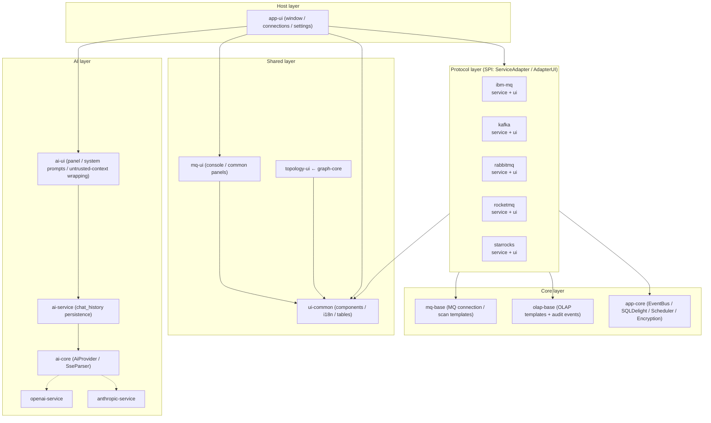

<div align="center">

# MQ Client Desktop

**A local desktop client for message middleware (IBM MQ / Kafka / RabbitMQ / RocketMQ) and StarRocks.**
Built with Kotlin Multiplatform + Compose Desktop; all data stays on the local machine.

[](https://kotlinlang.org)
[](https://www.jetbrains.com/lp/compose-multiplatform/)
[](https://openjdk.org)
[](https://github.com/cashapp/sqldelight)
[](LICENSE)

**English** · [简体中文](docs/README.zh-CN.md)

</div>

---

## Overview

MQ Client Desktop is a single-window desktop application that connects to four message
middleware products and to StarRocks. Each protocol is a pair of `service` / `ui` modules
registered into the host through SPI; removing a protocol pair does not affect compilation of
the rest of the application.

Connection settings, command history, query history and AI conversations are stored locally
under `~/.mqclient/`. No central service is involved.

### Supported systems

| Domain | Systems | Scope |
|---|---|---|
| Message middleware | IBM MQ, Kafka, RabbitMQ, RocketMQ | Object browsing, message browsing/sending, properties, topology |
| OLAP | StarRocks | Catalogs, SQL console, query profiles, cluster/system pages |

### AI-assisted diagnosis

Object pages expose an "Ask AI" entry point. The application assembles the object's context —
attributes, upstream/downstream topology, live backlog figures, cluster relations — into
structured text and sends it to an OpenAI-compatible or Anthropic endpoint (SSE streaming):

```text
Object attributes + upstream/downstream topology (producer / consumer / channel)
        + live backlog data (queue depth / consumer count / channel status)
        + cluster relations (cluster membership, repository role)
                    ↓
      OpenAI-compatible / Anthropic adapters (SSE streaming)
                    ↓
"XMITQ holds 3200 messages; DOWNSTREAM.CHL is RETRYING;
 the receiver channel on QM2 is not running."   ← reported root cause
```

Each MQ module provides its own chain builder (IBM MQ uses `AiChainBuilder`; Kafka, RabbitMQ and
RocketMQ use `KafkaAiChainBuilder` / `RabbitMqAiChainBuilder` / `RocketMqAiChainBuilder`).
For StarRocks, the SQL console and the session panel provide a slow-query diagnosis entry point
whose context contains the SQL text, the `EXPLAIN` plan and the column structure of the referenced
tables.

## Capabilities

### Message middleware

- **Three SPI layers** — `ServiceAdapter` (service side), `AdapterUI` (UI side) and
  `MessageInterpreter` (message body display). The core modules define contracts only; protocol
  modules are peers.
- **Protocol integration**:
  - **IBM MQ** — PCF object scanning (queues / channels / listeners), MQSC command console with
    MQRC error-code translation, dmpmqmsg migration-file import, TLS with `CipherSuiteOptions`.
  - **Kafka** — live reads through `assign + seek + poll`: no consumer group is joined and no
    offset is committed; multiple start points per read, partition-level cursor continuation.
  - **RabbitMQ** — management API for objects and status, `basicGet` browsing that leaves messages
    unacknowledged and requeues them on close, Stream-queue pre-check through the management API.
  - **RocketMQ** — Remoting protocol with ACL and TLS; when a topic has 64 or more queues, reads
    are sharded across 8 temporary pull consumers with a computed timeout.
- **Topology views** — `graph-core` (graph model) + `topology-ui` (Canvas renderer): node dragging,
  zoom, node detail panel, PNG export. IBM MQ uses a fixed-column layout that follows message flow.
- **Handle lifecycle** — heavy handles (`AdminClient`, `MQQueueManager`, producer) are shared at
  connection level and serialized by lock; light handles (consumer, channel, JDBC statement) are
  created per operation and closed in `finally`. `MQQueue` depends on the operation: the browse
  session keeps one handle open to preserve the server-side cursor and closes it with the session,
  while delete / requeue / send open a fresh handle and close it in `finally`.
- **Message body interpreters** — JSON, XML, Hex, Base64, plain text, SAP IDoc.
- **Local storage** — SQLite (SQLDelight) for connection snapshots, command audit and AI history;
  sensitive fields encrypted through the `@Sensitive` annotation.
- **Bilingual UI** — zh-CN and en-US resource tables per module.

### StarRocks

- **Connection** — MySQL protocol on the FE query port (9030); optional SSH tunnel with private key
  or password. The first connection records the host key fingerprint (trust-on-first-use) to
  `<configDir>/known_hosts` as `host keytype sha256-fingerprint`; later connections are verified
  against it, and a changed key blocks the connection until the user confirms.
- **Catalog** — tree of databases, tables, views and materialized views. Selecting a table loads a
  two-dimensional column table (name, type, nullable, key, default, extra, comment) and a DDL tab;
  partitions are summarized in a collapsible section.
- **SQL console** — tab strip over one editor and one result grid (tabs do not keep independent
  documents); execute selection or whole buffer, multiple statements in sequence, cancel, streamed
  results with a 50,000-row cap, sortable columns, hover/click detail for long values, CSV export
  (UTF-8 with BOM, atomic write), and a persistent execution history (`olap_query_history`).
- **Sessions and slow queries** — `SHOW PROFILELIST` listing; profile viewer that issues
  `ANALYZE PROFILE FROM '<id>'` and reports a "profile not collected" message when the statement
  fails or returns no text.
- **Cluster pages** — overview, three-tier topology (external catalogs → FE → BE/CN) with node
  property dialogs, BE/CN capacity and heartbeat, HA (leader, quorum, electable/observer nodes),
  variables (session / global / FE config), and FE log tail through the FE web port.
- **Logging** — `[StarRocks][Conn]` / `[SQL]` / `[Meta]` / `[Profile]` structured log tags, SQL
  statements truncated to 500 characters, credentials never logged.

## Feature matrix — message middleware

| Capability | IBM MQ | Kafka | RabbitMQ | RocketMQ |
|:---|:---:|:---:|:---:|:---:|
| Object scan / health | PCF (queues, channels, listeners) | Topics, consumer groups | Exchanges, queues, bindings, nodes | Topics, groups, cluster |
| Properties panel (grouped pipeline) | Full attribute extraction | Yes | Yes | Yes |
| Message browsing | Session-scoped cursor handle (server-side `BROWSE_NEXT` paging) | Assign + Seek, multiple start points | Non-destructive `basicGet` | Multi-queue parallel, multiple start points |
| Message sending | Yes | Yes | Batch files, test publish | Yes |
| Object CRUD | — | Topic config | Exchanges, bindings | Yes, with guard rails |
| Command console | MQSC (audited history) | — | — | — |
| Native topology | Cluster edge relations | Yes | Exchange → queue routing | Yes |
| AI chain diagnosis | Yes | Yes | Yes | Yes |
| TLS / self-signed certificates | Yes | SASL_SSL | Yes | Yes |

## Feature matrix — StarRocks

| Capability | Status |
|:---|:---|
| Connection | MySQL protocol; optional SSH tunnel (key or password); TOFU host-key verification |
| Catalog | Databases, tables, views, materialized views; column table; DDL; partition summary |
| SQL console | Tab strip (shared editor/result state), selection execution, multi-statement, cancel, streaming, sorting, CSV export, history |
| Diagnostics | `SHOW PROFILELIST`; `ANALYZE PROFILE FROM '<id>'`; AI slow-query analysis |
| Cluster | Overview, topology, BE/CN, HA, variables and FE config, FE logs |
| Object DDL/DML | Through the SQL console only (no GUI object editing) |

## Architecture



Dependency direction: UI → service → `mq-base` / `olap-base` / `app-core`, one-way. The reverse
direction uses EventBus events and SPI callbacks only. Each protocol ships as a peer `service` / `ui`
pair; adding a protocol means adding a pair of modules and an SPI registration.

> A module-by-module inventory, per-domain feature list and code metrics are in
> [`docs/ARCHITECTURE.md`](docs/ARCHITECTURE.md).

## Project layout

```text
mq-client/
├── app-core/            # EventBus, SQLDelight (6 tables), scheduler, encryption, SPI contracts
├── mq-base/             # AbstractConnectionManager / AbstractScanService templates
├── olap-base/           # OLAP templates: AbstractAnalyticsConnectionManager (in use) + catalog/query templates
├── ui-common/           # Component library: dialogs, PropertyTable, DataGrid, i18n
├── mq-ui/               # Shared MQ UI: command console, object list panels, MetricCard
├── graph-core/          # Topology graph model (TopologyData / TopologyNode)
├── topology-ui/         # Canvas renderer: dragging, zoom, PNG export
├── ibm-mq-service/  ibm-mq-ui/       # IBM MQ (PCF, MQSC, dmpmqmsg)
├── kafka-service/   kafka-ui/        # Kafka (Assign + Seek)
├── rabbitmq-service/ rabbitmq-ui/    # RabbitMQ (management API, basicGet)
├── rocketmq-service/ rocketmq-ui/    # RocketMQ (Remoting, parallel fetch)
├── starrocks-service/ starrocks-ui/  # StarRocks (catalog, SQL console, profile, cluster pages)
├── ai-core/  ai-service/  ai-ui/     # AI diagnosis stack
├── openai-service/  openai-ui/       # Provider pair
├── anthropic-service/ anthropic-ui/  # Provider pair
├── message-interpreter-api/          # Message interpreter SPI
│   ├── -json / -xml / -hex / -base64 / -text / -idoc
│   └── -registry                     # Aggregate registry
├── ui-test-kit/  test-support/       # Compose canvas test kit / LiveTest SKIP wrapper
└── app-ui/              # Desktop host (Main.kt / packaging)
```

## Getting started

**Requirements**: JDK 25 (the build targets `jvmToolchain(25)`), Gradle wrapper 9.7.1.

```bash
git clone <your-repo-url>
cd mq-client
./gradlew :app-ui:run          # development run
```

**Verification** (architecture rules + assemble + unit tests + i18n key checks):

```bash
bash ./scripts/verify.sh
```

**Packaging** (portable zip, no installer):

```bash
./build.bat            # Windows
./build.sh             # Linux / macOS
# or directly:
./gradlew :app-ui:zipDistributable
```

Artifacts are written to `app-ui/build/compose/binaries/main/` and named
`MQClient-0.2.0-<os>-<arch>.zip`. jpackage can only package the host operating system, so each
platform's zip must be built on that platform. The archive contains a trimmed JRE; unzip and run
`MQClient/MQClient.exe` (Windows) or `./MQClient/bin/MQClient` (Linux/macOS).

**Data directory** — everything is stored under `~/.mqclient/`:

```text
~/.mqclient/
├── config.toml    # connections and application settings
├── secret.key     # encryption key for sensitive fields
├── mqclient.db    # SQLite: mq_connection / mq_command / ai_connection / chat_history
│                  #         olap_query_history / olap_draft
├── known_hosts    # SSH host keys remembered for the StarRocks tunnel (host, key type, SHA-256 fingerprint)
└── logs/          # runtime logs, including [MQ-Perf] and [StarRocks] traces
```

## Codebase metrics

Measured over the working tree at the 0.2.0 release (`find`/`wc -l` over `src/**/*.kt`,
excluding `build/`):

| Metric | Value |
|:---|:---|
| Gradle modules | 35 (+ included build for version catalog / convention plugins) |
| Kotlin files | 753 (532 main, 221 test) |
| Kotlin lines | 119,328 (90,104 main, 29,224 test) |
| `@Composable` declarations | 522 |
| `suspend fun` declarations | 527 (including `expect` / `actual` pairs) |
| SQLDelight tables | 6 |

## Limitations

- Object DDL and DML are performed through the SQL console only; there is no GUI object editor.
- The SQL console has no autocomplete and no statement formatter, and no database selector — the
  session uses the connection's default database unless a `USE` statement is issued.
- Console tabs share one editor and one result grid; switching tabs does not switch documents.
- One connection executes one statement at a time (single shared session).
- Result sets are capped at 50,000 rows; the excess is truncated with a banner, and there is no
  paging continuation.
- No dedicated TLS toggle in the connection form; TLS parameters go through `jdbcUrlOverride`.
- StarRocks support has been verified against StarRocks 3.4.0 on a single-node instance, not against
  multi-BE production clusters or other versions.

## Contributing

Bug reports, feature requests, documentation fixes and pull requests are welcome.

```bash
# 1. Fork and create a branch
git checkout -b feat/your-feature

# 2. Self-check: build + unit tests
./gradlew build
./gradlew jvmTest

# 3. Commit and open a pull request
```

**Conventions**:

- **Commit messages** — Conventional Commits (`feat:` / `fix:` / `refactor:` / `docs:`), body
  explaining motivation and scope.
- **i18n** — every user-visible string ships both `zh-CN` and `en-US` resources; no hardcoded
  strings.
- **UI components** — reuse `ui-common` components (`PropertyTable`, `DataGrid`, `PrimaryButton` /
  `SecondaryButton` / `DangerButton`, `ObjectDetailDialog`) instead of writing local equivalents.
- **Architecture boundaries** — `service` modules must not depend on `ui` modules; cross-module
  communication goes through SPI contracts and the EventBus.
- **Error handling** — raw error codes and stack traces stay in logs; the UI shows text translated
  through `userMessage()`.
- **Handle lifecycle** — heavy handles are shared at connection level under lock; light handles are
  created per operation and closed in `finally`, except the messaging browse cursor which stays
  open for the session so paging remains server-side.
- **Tests** — new service-layer logic requires `jvmTest`. Protocol-behavior tests must not require
  a live broker; real-environment checks run as `*LiveTest` guarded by a `-D*.live.enabled=true`
  system property and skip when the environment is absent.

**Issue reports**: include the OS, JDK version, reproduction steps and the relevant lines from
`~/.mqclient/logs/`. Redact credentials.

## License

Apache License 2.0 — see [LICENSE](LICENSE).

```text
Copyright 2026 Lindc

Licensed under the Apache License, Version 2.0 (the "License");
you may not use this file except in compliance with the License.
You may obtain a copy of the License at

    http://www.apache.org/licenses/LICENSE-2.0
```
