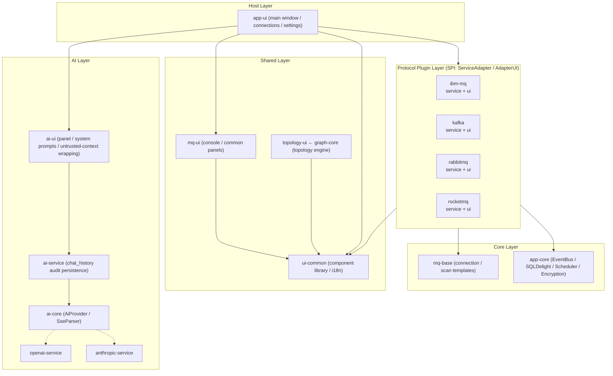

<div align="center">

# MQ Client Desktop

**A local-first, multi-protocol desktop workbench for message middleware — with AI-powered chain diagnosis**

基于 Kotlin Multiplatform + Compose Desktop 构建的本地优先、多协议统一桌面工作台。

[](https://kotlinlang.org)
[](https://www.jetbrains.com/lp/compose-multiplatform/)
[](https://openjdk.org)
[](https://github.com/cashapp/sqldelight)
[](LICENSE)

**English** · [简体中文](README.zh.md)

</div>

---

## 🎯 Why this exists

If you operate message middleware, you know the drill: MQ Explorer for IBM MQ, kafka-tool for Kafka, a browser tab for RabbitMQ, yet another console for RocketMQ. Four tools, four mental models, four sets of scattered connection configs — and by the time you notice the queue is piling up, the real problem is often sitting on a **channel at the other end of the chain**.

MQ Client Desktop pulls all of that into a single local desktop app, and does one thing nobody else does: **it hands the entire message chain to the AI**.

Click "Ask AI" on any object page, and the app packages the full picture of that object into structured context:

```text
Object attributes + upstream/downstream topology (who produces, who consumes, via which channel)
        + live backlog data (queue depth / consumer count / channel status)
        + cluster relations (cluster membership, repository role)
                    ↓
      OpenAI-compatible / Anthropic adapters (SSE streaming)
                    ↓
"XMITQ has 3200 messages backed up, DOWNSTREAM.CHL is RETRYING,
 the receiver channel on QM2 isn't running" ← root cause
```

Each of the four MQ modules ships its own chain builder (`IbmMqAiChainBuilder` / `KafkaAiChainBuilder` / …), turning "things you can't see in a table" into text the AI can reason over.

## ✨ Highlights

- **🔌 Unified multi-protocol abstraction** — Three SPI layers (`ServiceAdapter` / `AdapterUI` / `MessageInterpreter`): the core defines contracts only, and all four major middlewares plug in. Removing any protocol doesn't break the host build. 33 Gradle modules, with `mq-base` carrying the connection/scan skeletons of four protocols in just 1.3K lines of templates.
- **⚙️ Deep native protocol integration** — No neutered REST proxies:
  - **IBM MQ**: full PCF object scanning + MQSC command console (with MQRC error-code translation) + dmpmqmsg migration-file import;
  - **Kafka**: direct `assign + seek + poll` live queries — no consumer group, no offset commits, multi-startpoint targeted browsing;
  - **RabbitMQ**: full management API + non-destructive `basicGet` browsing (unacked holds, auto-requeue on close) + Stream-queue pre-flight interception;
  - **RocketMQ**: Remoting protocol + ACL/TLS, queue-count-adaptive parallel fetching (8 shard-local temporary consumers + dynamic timeout).
- **🛡️ Prompt-injection hardening** — Untrusted data is wrapped in `[BEGIN/END UNTRUSTED CONTEXT]` boundaries, backed by a security rule in the system prompt and full-width neutralization of forged boundaries. One pipeline covers all four protocols.
- **🕸️ Topology visualization** — `graph-core` (pure graph model) + `topology-ui` (Canvas rendering engine): node dragging, zoom, double-click details, PNG export; every protocol gets its own topology view (IBM MQ uses a fixed-column layout following message flow).
- **🧩 Handle-isolation discipline** — "Share heavy connections, destroy light handles after use": heavy handles (AdminClient / MQQueueManager / Producer) are connection-level shared with lock serialization; light handles (Consumer / MQQueue / Channel) are created per operation and released in `finally`. A single protocol failure never takes down the app.
- **🛠️ Engineering polish** — Bilingual i18n (zh-CN / en-US), smart message-body interpreters (JSON / XML / Hex / Base64 / SAP IDoc), `@Sensitive`-annotation-driven local encryption, SQLite operation auditing, and `[MQ-Perf]` structured timing logs across the whole fetch chain (4 UI checkpoints + 5 service segments: instance / io / parse / total).

## 📊 Feature Matrix

| Capability | IBM MQ | Kafka | RabbitMQ | RocketMQ |
|:---|:---:|:---:|:---:|:---:|
| Object scan / health | ✅ Full PCF (queues/channels/listeners) | ✅ Topics / consumer groups | ✅ Exchanges / queues / bindings / nodes | ✅ Topics / groups / cluster |
| Properties panel (grouped pipeline) | ✅ MQ Explorer-grade attrs | ✅ | ✅ | ✅ |
| Message browsing | ✅ Per-op handles, cursor-equivalent paging | ✅ Assign+Seek, multi-startpoint | ✅ Non-destructive basicGet | ✅ Multi-queue parallel, multi-startpoint |
| Message sending | ✅ | ✅ | ✅ Batch files / test publish | ✅ |
| Object CRUD | — | ✅ Topic config | ✅ Exchanges / bindings | ✅ With guard rails |
| Command console | ✅ MQSC (audited history) | — | — | — |
| Native topology | ✅ Cluster edge relations | ✅ | ✅ Exchange→Queue routing | ✅ |
| AI chain diagnosis | ✅ | ✅ | ✅ | ✅ |
| TLS / self-signed certs | ✅ | ✅ SASL_SSL | ✅ | ✅ |

## 🏗️ Architecture



Iron rule of dependency direction: **UI → Service → mq-base / app-core, one-way**; the reverse direction communicates only through EventBus events and SPI callbacks. Every MQ protocol ships as a peer `service`/`ui` pair — adding a protocol means one pair of modules inheriting the templates, with zero platform-layer changes.

> 📐 A full architecture & feature inventory (all 33 modules, per-domain feature list, codebase metrics) lives in [`docs/ARCHITECTURE.md`](docs/ARCHITECTURE.md).

## 📁 Project Layout

```text
mq-client/
├── app-core/            # Platform foundation: EventBus, SQLDelight (4 tables), scheduler, encryption, SPI contracts
├── mq-base/             # AbstractConnectionManager / AbstractScanService templates
├── ui-common/           # Compose component library: DecoratedDialog, PropertyTable, i18n
├── mq-ui/               # Shared MQ UI: command console, object list panels, MetricCard
├── graph-core/          # TopologyGraph pure model
├── topology-ui/         # Topology rendering: Canvas, node dragging, zoom, PNG export
├── ibm-mq-service/  ibm-mq-ui/       # IBM MQ plugin (PCF + MQSC + dmpmqmsg)
├── kafka-service/   kafka-ui/        # Kafka plugin (Assign+Seek live browsing)
├── rabbitmq-service/ rabbitmq-ui/    # RabbitMQ plugin (management API + connection self-healing)
├── rocketmq-service/ rocketmq-ui/    # RocketMQ plugin (Remoting + parallel fetching)
├── ai-core/  ai-service/  ai-ui/     # AI diagnosis stack
├── openai-service/  openai-ui/       # Provider plugin pair
├── anthropic-service/ anthropic-ui/  # Provider plugin pair
├── message-interpreter-api/          # Message interpreter SPI
│   ├── -json / -xml / -hex / -base64 / -text / -idoc
│   └── -registry                     # Aggregate registry
├── ui-test-kit/  test-support/       # Compose canvas test kit / LiveTest SKIP wrapper
└── app-ui/              # Desktop host (Main.kt / packaging config)
```

## 🚀 Getting Started

**Requirements**: JDK 25

```bash
git clone <your-repo-url>
cd mq-client
./gradlew :app-ui:run          # development run
```

**Packaging** (portable zip, no MSI installer):

```bash
# one-liner per platform (auto-detects JDK 25, auto-names the zip by host OS):
./build.bat            # Windows
./build.sh             # Linux / macOS
# or via gradle directly:
./gradlew :app-ui:zipDistributable
```

Artifacts land in `app-ui/build/compose/binaries/main/` —
`MQClient-0.1.0-windows-x64.zip` / `-linux-x64.zip` / `-macos-x64.zip` / `-macos-arm64.zip`
(jpackage only packages the **current** OS — build each platform on that platform).
Unzip and run `MQClient/MQClient.exe` (Windows) or `./MQClient/bin/MQClient`
(Linux/macOS) — ships with a trimmed JRE (jpackage with an explicit module list),
no JDK installation needed.

**Data directory**: everything lives under `~/.mqclient/`:

```text
~/.mqclient/
├── config.toml    # connection & app config
├── secret.key     # encryption key for sensitive data
├── mqclient.db    # SQLite (connection snapshots / command audit / AI history)
└── logs/          # runtime logs (incl. [MQ-Perf] end-to-end timing traces)
```

## 📊 Codebase at a Glance

| Metric | Value |
|:---|:---|
| Gradle modules | 33 (+ included build for version catalog / convention plugins) |
| Kotlin source | ~87.5K lines / ~534 files (plus 12.1K lines of tests / 85 files) |
| `@Composable` | 512 |
| `suspend fun` | 276 |
| SQLDelight tables | 4 |

## 🤝 Contributing

All kinds of contributions are welcome: bug reports, feature requests, documentation improvements, and code PRs.

```bash
# 1. Fork and create a feature branch
git checkout -b feat/your-feature

# 2. Self-check: build + unit tests
./gradlew build     # full build
./gradlew jvmTest   # per-module unit tests

# 3. Commit and open a Pull Request
```

**Conventions**:

- **Commit messages**: follow Conventional Commits (`feat:` / `fix:` / `refactor:` / `docs:`), with the body explaining motivation and scope;
- **i18n**: every user-visible string must ship both `zh-CN` and `en-US` resources — no hardcoded strings;
- **UI components**: prefer existing `ui-common` components (`PropertyTable`, `PrimaryButton`/`SecondaryButton`/`DangerButton`, `ObjectDetailDialog`, etc.);
- **Architecture boundaries**: `service` modules must not depend on `ui` modules; cross-module communication goes through SPI contracts and the EventBus, never direct implementation references;
- **Error handling**: raw error codes / stack traces stay in logs only; the UI must display friendly text translated via `userMessage()`;
- **Handle lifecycle**: follow "share heavy connections, destroy light handles after use" — heavy handles are connection-level shared with lock serialization; light handles are created per operation and released in `finally`;
- **Tests**: new service-layer logic requires jvmTest; protocol-behavior tests must not require a live broker (real-broker verification uses `-D*diag.enabled=true` LiveTests, which SKIP automatically without an environment).

**Issue reports**: please include your OS, JDK version, reproduction steps, and the relevant snippet from `~/.mqclient/logs/` (redact credentials — never paste connection secrets).

## 📄 License

This project is released under the [Apache License 2.0](LICENSE).

```text
Copyright 2026 Lindc

Licensed under the Apache License, Version 2.0 (the "License");
you may not use this file except in compliance with the License.
You may obtain a copy of the License at

    http://www.apache.org/licenses/LICENSE-2.0
```
