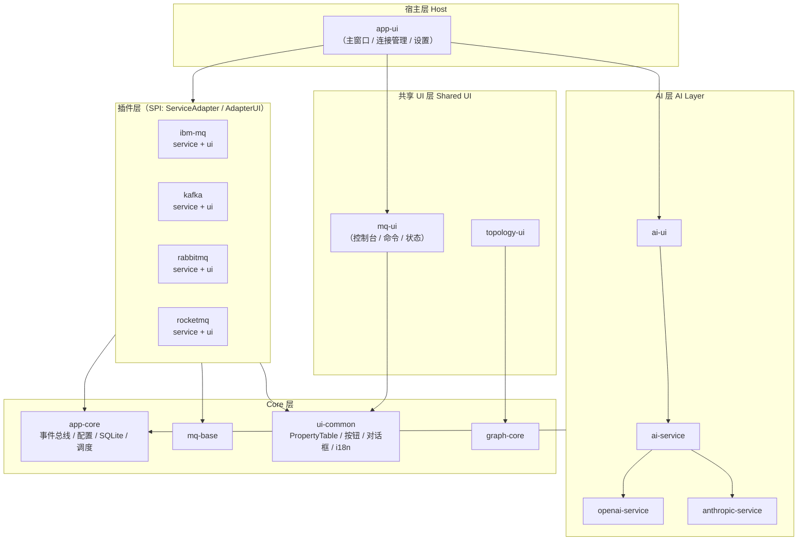
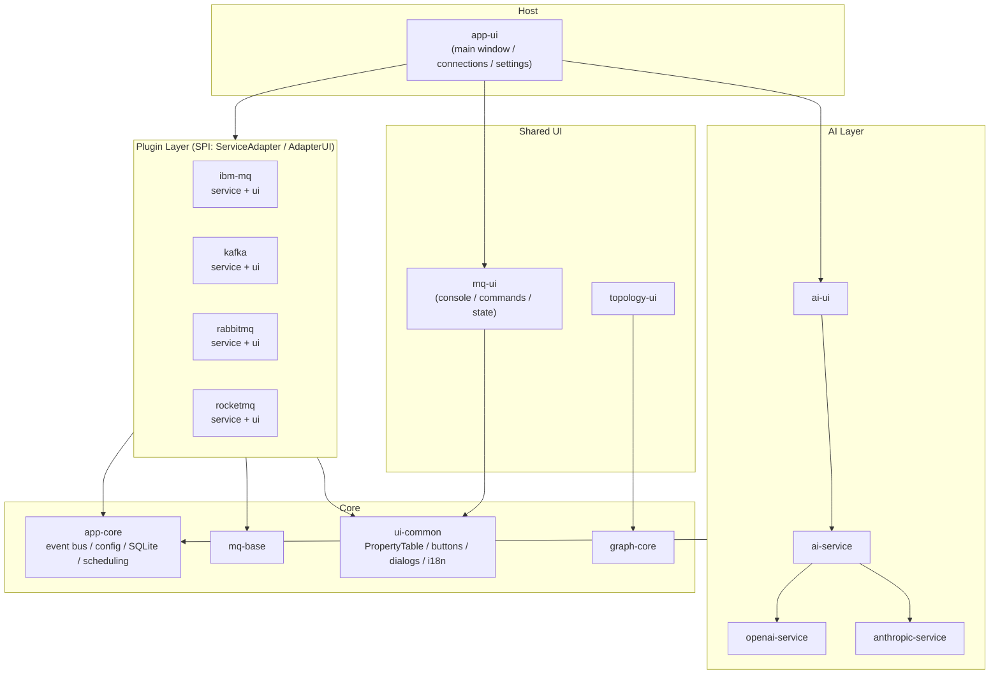

<div align="center">

# MQ Client Desktop

**多协议消息队列统一管理客户端 · Unified Multi-Protocol Message Queue Management Client**

基于 Kotlin Multiplatform + Compose Desktop 构建的本地优先、多协议、深度集成的现代化桌面端中间件管理工具。

[](https://kotlinlang.org)
[](https://www.jetbrains.com/lp/compose-multiplatform/)
[](https://openjdk.org)
[](https://github.com/cashapp/sqldelight)
[](#-license)

</div>

---

## 📸 界面预览

> 截图待补充：将 `dashboard.png` / `topology.png` / `messages.png` / `ai-diagnostics.png` 放入 `docs/images/` 后即可显示。

## ✨ 核心亮点

- **🔌 多协议统一抽象** — 通过 SPI 机制（`ServiceAdapter` / `AdapterUI`）实现高度解耦：核心层只定义契约，四大主流中间件以插件形式无缝接入，一套 UI 框架通吃。
- **⚙️ 原生协议深度接入** — 不依赖阉割的 REST Proxy：
  - **IBM MQ**：PCF 全对象扫描 + MQSC 控制台直连；
  - **Kafka**：Assign + Seek 实现无消费组偏移量的定点消息浏览；
  - **RabbitMQ**：`basicGet` 防吞机制（不消费、不改变队列状态）；
  - **RocketMQ**：底层 Remoting 协议实现，含 TLS/SSL 上下文深度兼容。
- **🤖 AI 链路诊断（杀手锏）** — 针对每个对象自动构建上下游拓扑链路的 JSON 上下文，适配 OpenAI / Anthropic 双引擎，内置中立化 Prompt，一键基于 AI 进行精准排障与积压分析。
- **🕸️ 拓扑可视化** — 基于 `graph-core` 与 kuiver 渲染引擎，四种 MQ 各有专属拓扑视图，支持节点拖拽、双击查看属性与一键导出。
- **🛠️ 工程化完备** — 暗黑/浅色主题、中英双语 i18n、消息正文智能解释器（JSON / XML / SAP IDOC）、本地敏感数据 AES-256 加密、SQLite 操作审计记录（mq_command 全量留痕）。

## 📊 功能支持矩阵

| 功能能力 | IBM MQ | Kafka | RabbitMQ | RocketMQ |
|:---|:---:|:---:|:---:|:---:|
| 完整对象树 / 扫描 | ✅ PCF 全对象 | ✅ Topic / Group | ✅ 健康度概览 | ✅ Topic / Group / Cluster |
| 属性面板（分组管线） | ✅ | ✅ | ✅ | ✅ |
| 消息浏览 | ✅ | ✅ Assign + Seek 定点 | ✅ basicGet 只读防吞 | ✅ 按队列 / Offset 定点 |
| 消息发送 | ✅ | ✅ | ✅ | ✅ Tag / Keys / 用户属性 |
| 对象 CRUD | — | ✅ Topic | ✅ 队列 / 交换机 / 绑定 | ✅ Topic / Group（防呆拦截） |
| 控制台 / 命令 | ✅ MQSC | — | — | — |
| 原生拓扑图 | ✅ | ✅ | ✅ 路由拓扑 | ✅ |
| AI 链路诊断 | ✅ | ✅ | ✅ | ✅ |
| 写操作审计 | ✅ | ✅ | ✅ | ✅ |

## 🏗️ 系统架构



## 📁 项目结构

```text
mq-client/
├── app-core/            # 事件总线、配置、SQLite(SQLDelight)、调度
├── mq-base/             # 中间件通用契约与工具
├── ui-common/           # 通用 UI 组件（PropertyTable / 按钮 / 对话框 / i18n）
├── graph-core/          # 拓扑图数据模型
├── topology-ui/         # 拓扑渲染（kuiver 引擎）
├── mq-ui/               # 共享业务 UI（命令控制台 / 通用状态）
├── ibm-mq-service/  ibm-mq-ui/       # IBM MQ 插件（PCF + MQSC）
├── kafka-service/   kafka-ui/        # Kafka 插件
├── rabbitmq-service/ rabbitmq-ui/    # RabbitMQ 插件（管理 API + AMQP）
├── rocketmq-service/ rocketmq-ui/    # RocketMQ 插件（Remoting）
├── openai-service/  anthropic-service/ ai-service/ ai-ui/   # AI 诊断
└── app-ui/              # 桌面宿主
```

## 🚀 快速开始

**环境要求**：JDK 25

```bash
git clone <your-repo-url>
cd mq-client
./gradlew run
```

**数据目录**：所有本地数据统一存储于 `~/.mqclient/` 下：

```text
~/.mqclient/
├── config.toml   # 连接与应用配置
├── secret.key    # 敏感数据加密密钥（AES-256）
├── mqclient.db   # SQLite（审计 / 会话 / AI 历史）
└── logs/         # 运行日志
```

## 🤝 贡献指南

欢迎任何形式的贡献：Bug 报告、功能建议、文档改进与代码 PR。

**开发流程**：

```bash
# 1. Fork 并创建特性分支
git checkout -b feat/your-feature

# 2. 开发自检：编译 + 单测
./gradlew build          # 全量构建
./gradlew jvmTest        # 各模块单元测试

# 3. 提交并推送，发起 Pull Request
```

**约定**：

- **提交信息**：遵循 Conventional Commits（`feat:` / `fix:` / `refactor:` / `style:` / `docs:`），正文说明动机与影响范围；
- **i18n**：所有用户可见文案必须同时提供 `zh-CN` 与 `en-US` 两份资源，禁止硬编码字符串；
- **UI 组件**：优先复用 `ui-common` 的既有组件（`PropertyTable`、`PrimaryButton` / `SecondaryButton` / `DangerButton`、`ObjectDetailDialog` 等），禁止在业务模块手写同类样式；
- **架构边界**：`service` 模块不得依赖 `ui` 模块；跨模块通信走 SPI 契约与事件总线，不直接引用实现；
- **错误处理**：原始错误码 / 异常栈只在日志留痕，UI 层必须展示转义后的友好文案；
- **测试**：新增 service 层逻辑需附带 jvmTest；涉及协议行为的用例不应依赖真实中间件实例。

**Issue 规范**：请附上操作系统、JDK 版本、复现步骤与 `~/.mqclient/logs/` 中的相关日志片段（注意脱敏，勿贴连接凭据）。

## 📄 License

本项目基于 [Apache License 2.0](LICENSE) 开源发布。

```text
Copyright 2026 Lindc

Licensed under the Apache License, Version 2.0 (the "License");
you may not use this file except in compliance with the License.
You may obtain a copy of the License at

    http://www.apache.org/licenses/LICENSE-2.0

Unless required by applicable law or agreed to in writing, software
distributed under the License is distributed on an "AS IS" BASIS,
WITHOUT WARRANTIES OR CONDITIONS OF ANY KIND, either express or implied.
See the License for the specific language governing permissions and
limitations under the License.
```

- 完整协议文本见仓库根目录的 [`LICENSE`](LICENSE) 文件（[Apache-2.0 全文](https://www.apache.org/licenses/LICENSE-2.0.txt)）；
- 按协议要求，源码文件头部建议附上标准 Apache 2.0 版权声明（`Copyright 2026 Lindc`）；如项目包含 NOTICE 所需的署名信息，请一并维护 `NOTICE` 文件。

---
---

<div align="center">

# MQ Client Desktop (English)

**A local-first, multi-protocol, deeply integrated desktop middleware management tool,
built on Kotlin Multiplatform + Compose Desktop.**

</div>

---

## 📸 Screenshots

> 截图待补充：将 `dashboard.png` / `topology.png` / `messages.png` / `ai-diagnostics.png` 放入 `docs/images/` 后即可显示。

## ✨ Highlights

- **🔌 Unified Multi-Protocol Abstraction** — A highly decoupled SPI design (`ServiceAdapter` / `AdapterUI`): the core defines the contract, and four mainstream middleware products plug in seamlessly behind one UI framework.
- **⚙️ Native Protocol Depth** — No crippled REST proxies:
  - **IBM MQ**: full PCF object scanning + direct MQSC console;
  - **Kafka**: Assign + Seek for offset browsing without consumer groups;
  - **RabbitMQ**: `basicGet` read-only browsing that never consumes queue state;
  - **RocketMQ**: low-level Remoting protocol with deep TLS/SSL compatibility.
- **🤖 AI Link Diagnostics (Killer Feature)** — Automatically builds a JSON context of each object's upstream/downstream topology, works with OpenAI / Anthropic, ships with neutralized prompts for precise troubleshooting and backlog analysis in one click.
- **🕸️ Topology Visualization** — Powered by `graph-core` and the kuiver rendering engine: dedicated topology views for all four MQs with node dragging, double-click properties, and one-click export.
- **🛠️ Production-Grade Engineering** — Dark/light themes, bilingual i18n (zh/en), smart message body interpreters (JSON / XML / SAP IDOC), AES-256 encryption for local secrets, and SQLite-based operation auditing (`mq_command`).

## 📊 Feature Matrix

| Capability | IBM MQ | Kafka | RabbitMQ | RocketMQ |
|:---|:---:|:---:|:---:|:---:|
| Full object tree / scan | ✅ PCF | ✅ Topic / Group | ✅ Health overview | ✅ Topic / Group / Cluster |
| Properties panel | ✅ | ✅ | ✅ | ✅ |
| Message browsing | ✅ | ✅ Assign + Seek | ✅ Read-only basicGet | ✅ Per-queue / offset |
| Message sending | ✅ | ✅ | ✅ | ✅ Tags / Keys / properties |
| Object CRUD | — | ✅ Topic | ✅ Queue / Exchange / Binding | ✅ Topic / Group (guarded) |
| Console / commands | ✅ MQSC | — | — | — |
| Native topology | ✅ | ✅ | ✅ Routing | ✅ |
| AI link diagnostics | ✅ | ✅ | ✅ | ✅ |
| Write auditing | ✅ | ✅ | ✅ | ✅ |

## 🏗️ Architecture



## 📁 Project Layout

```text
mq-client/
├── app-core/            # Event bus, config, SQLite (SQLDelight), scheduling
├── mq-base/             # Shared middleware contracts & utilities
├── ui-common/           # Shared UI components (PropertyTable / buttons / dialogs / i18n)
├── graph-core/          # Topology data model
├── topology-ui/         # Topology rendering (kuiver engine)
├── mq-ui/               # Shared business UI (command console / common state)
├── ibm-mq-service/  ibm-mq-ui/       # IBM MQ plugin (PCF + MQSC)
├── kafka-service/   kafka-ui/        # Kafka plugin
├── rabbitmq-service/ rabbitmq-ui/    # RabbitMQ plugin (management API + AMQP)
├── rocketmq-service/ rocketmq-ui/    # RocketMQ plugin (Remoting)
├── openai-service/  anthropic-service/ ai-service/ ai-ui/   # AI diagnostics
└── app-ui/              # Desktop host
```

## 🚀 Quick Start

**Requirements**: JDK 25

```bash
git clone <your-repo-url>
cd mq-client
./gradlew run
```

**Data directory**: all local data lives under `~/.mqclient/`:

```text
~/.mqclient/
├── config.toml   # Connection & application config
├── secret.key    # Sensitive-data encryption key (AES-256)
├── mqclient.db   # SQLite (audit / sessions / AI history)
└── logs/         # Runtime logs
```

## 🤝 Contributing

Contributions of all kinds are welcome: bug reports, feature proposals, documentation improvements, and pull requests.

**Workflow**:

```bash
# 1. Fork and create a feature branch
git checkout -b feat/your-feature

# 2. Self-check: build + tests
./gradlew build
./gradlew jvmTest

# 3. Push and open a Pull Request
```

**Conventions**:

- **Commit messages**: follow Conventional Commits (`feat:` / `fix:` / `refactor:` / `style:` / `docs:`); the body should explain motivation and scope;
- **i18n**: every user-visible string must exist in both `zh-CN` and `en-US` resources; hard-coded strings are not allowed;
- **UI components**: reuse existing `ui-common` components (`PropertyTable`, `PrimaryButton` / `SecondaryButton` / `DangerButton`, `ObjectDetailDialog`, ...); do not hand-roll duplicate styles in feature modules;
- **Architecture boundaries**: `service` modules must not depend on `ui` modules; cross-module communication goes through SPI contracts and the event bus, never direct implementation references;
- **Error handling**: raw error codes / stack traces stay in logs only; the UI must present user-friendly, translated messages;
- **Tests**: new service-layer logic requires jvmTest coverage; protocol-behavior tests must not depend on live middleware instances.

**Issue guidelines**: include your OS, JDK version, reproduction steps, and the relevant excerpts from `~/.mqclient/logs/` (redact credentials before posting).

## 📄 License

This project is licensed under the [Apache License 2.0](LICENSE).

```text
Copyright 2026 Lindc

Licensed under the Apache License, Version 2.0 (the "License");
you may not use this file except in compliance with the License.
You may obtain a copy of the License at

    http://www.apache.org/licenses/LICENSE-2.0

Unless required by applicable law or agreed to in writing, software
distributed under the License is distributed on an "AS IS" BASIS,
WITHOUT WARRANTIES OR CONDITIONS OF ANY KIND, either express or implied.
See the License for the specific language governing permissions and
limitations under the License.
```

- The full license text is available in the [`LICENSE`](LICENSE) file at the repository root ([Apache-2.0 full text](https://www.apache.org/licenses/LICENSE-2.0.txt));
- Per the license, source files should carry the standard Apache 2.0 header (`Copyright 2026 Lindc`); if the project requires attribution covered by a NOTICE file, maintain `NOTICE` accordingly.
