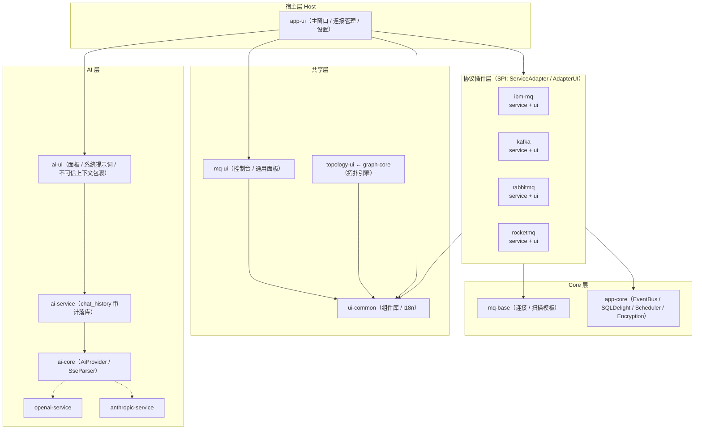

<div align="center">

# MQ Client Desktop

**本地优先 · 多协议统一 · AI 链路诊断的桌面消息中间件工作台**

A local-first, multi-protocol desktop workbench for message middleware,
built on Kotlin Multiplatform + Compose Desktop.

[](https://kotlinlang.org)
[](https://www.jetbrains.com/lp/compose-multiplatform/)
[](https://openjdk.org)
[](https://github.com/cashapp/sqldelight)
[](LICENSE)

[English](README.md) · **简体中文**

</div>

---

## 🎯 为什么做它

运维中间件的人都经历过：IBM MQ 用 MQ Explorer、Kafka 用 kafka-tool、RabbitMQ 开浏览器、RocketMQ 再装一套控制台。四个工具、四套心智模型、四份散落的连接配置 —— 而当你终于看到「队列在堆积」时，真正的问题往往在**另一端的通道**上。

MQ Client Desktop 把这些收进一个本地桌面应用，并且做了一件别处没有的事：**把整条消息链路交给 AI 看**。

点击任意对象页的「询问 AI」，应用把当前对象的完整图景打包成结构化上下文：

```text
对象属性 + 上下游拓扑（谁生产、谁消费、经哪条通道）
        + 实时积压数据（队列深度 / 消费者数 / 通道状态）
        + 集群关系（是否集群成员、仓库角色）
                    ↓
      OpenAI 兼容 / Anthropic 适配器（SSE 流式）
                    ↓
「XMITQ 堆积 3200 条，DOWNSTREAM.CHL 状态 RETRYING，
  对端 QM2 集群接收通道未运行」← 根因定位
```

四个 MQ 模块各有专属的链路构建器（`IbmMqAiChainBuilder` / `KafkaAiChainBuilder` / …），把「表格里看不出来的东西」变成 AI 能推理的文本。

## ✨ 核心亮点

- **🔌 多协议统一抽象** — 三层 SPI（`ServiceAdapter` / `AdapterUI` / `MessageInterpreter`）：核心层只定义契约，四大主流中间件以插件形式接入，删除任一协议不影响宿主编译。33 个 Gradle 模块，`mq-base` 以 1.3K 行模板承载四个协议的连接/扫描骨架。
- **⚙️ 原生协议深度接入** — 不依赖阉割的 REST Proxy：
  - **IBM MQ**：PCF 全对象扫描 + MQSC 命令控制台（MQRC 错误码翻译表）+ dmpmqmsg 搬移文件导入；
  - **Kafka**：`assign + seek + poll` 直连实时查询，不建消费组、不提交位移，多起点定点浏览；
  - **RabbitMQ**：管理 API 全套 + `basicGet` 只读防吞（unacked 持有、关闭自动重入队）+ Stream 队列前置拦截；
  - **RocketMQ**：Remoting 协议 + ACL/TLS，队列数自适应并行拉取（8 分片临时 Consumer + 动态超时）。
- **🛡️ Prompt 注入加固** — 不可信数据以 `[BEGIN/END UNTRUSTED CONTEXT]` 边界包裹 + 系统提示词安全规则 + 伪造边界全角中和，单一管线覆盖四个协议。
- **🕸️ 拓扑可视化** — `graph-core` 纯图模型 + `topology-ui` Canvas 渲染引擎：节点拖拽、缩放、双击属性、PNG 导出；四协议各有专属拓扑视图（IBM MQ 按消息流向固定列布局）。
- **🧩 句柄隔离规范** — 「底层连接共享，业务句柄用完即毁」：重量级句柄（AdminClient / MQQueueManager / Producer）连接级共享 + 锁串行化，轻量句柄（Consumer / MQQueue / Channel）每操作独立 + `finally` 释放，单次协议异常不再拖垮全局。
- **🛠️ 工程化完备** — 中英双语 i18n、消息体智能解释器（JSON / XML / Hex / Base64 / SAP IDoc）、`@Sensitive` 注解驱动的本地加密、SQLite 操作审计、`[MQ-Perf]` 全链路结构化耗时日志（UI 四点 + Service 五段：instance / io / parse / total）。

## 📊 功能支持矩阵

| 能力 | IBM MQ | Kafka | RabbitMQ | RocketMQ |
|:---|:---:|:---:|:---:|:---:|
| 对象扫描 / 健康度 | ✅ PCF 全对象（队列/通道/监听器） | ✅ Topic / Consumer Group | ✅ 交换机 / 队列 / 绑定 / 节点 | ✅ Topic / Group / Cluster |
| 属性面板（分组管线） | ✅ MQ Explorer 级 attrs 提取 | ✅ | ✅ | ✅ |
| 消息浏览 | ✅ 独立句柄 + 光标等价翻页 | ✅ Assign+Seek 定点、多起点 | ✅ basicGet 只读防吞 | ✅ 多队列并行、多起点 |
| 消息发送 | ✅ | ✅ | ✅ 批量文件 / 测试发布 | ✅ |
| 对象 CRUD | — | ✅ Topic 配置 | ✅ 交换机 / 绑定 | ✅ 防呆拦截 |
| 命令控制台 | ✅ MQSC（历史审计） | — | — | — |
| 原生拓扑图 | ✅ 集群边关系 | ✅ | ✅ Exchange→Queue 路由 | ✅ |
| AI 链路诊断 | ✅ | ✅ | ✅ | ✅ |
| TLS / 自签证书 | ✅ | ✅ SASL_SSL | ✅ | ✅ |

## 🏗️ 系统架构



依赖方向铁律：**UI → Service → mq-base / app-core，单向**；反向只通过 EventBus 事件与 SPI 回调。每个 MQ 的 `service` / `ui` 平级成对，新增协议 = 一对模块继承模板，平台层零改动。

> 📐 完整的架构与功能盘点（33 个模块逐一说明、分业务域功能清单、代码量化指标）见 [`docs/ARCHITECTURE.md`](docs/ARCHITECTURE.md)。

## 📁 项目结构

```text
mq-client/
├── app-core/            # 平台底座：EventBus、SQLDelight(4表)、调度、加密、SPI 契约
├── mq-base/             # AbstractConnectionManager / AbstractScanService 模板
├── ui-common/           # Compose 组件库：DecoratedDialog、PropertyTable、i18n
├── mq-ui/               # MQ 通用 UI：命令控制台、对象列表面板、MetricCard
├── graph-core/          # TopologyGraph 纯图模型
├── topology-ui/         # 拓扑渲染：Canvas、节点拖拽、缩放、PNG 导出
├── ibm-mq-service/  ibm-mq-ui/       # IBM MQ 插件（PCF + MQSC + dmpmqmsg）
├── kafka-service/   kafka-ui/        # Kafka 插件（Assign+Seek 实时浏览）
├── rabbitmq-service/ rabbitmq-ui/    # RabbitMQ 插件（管理 API + 连接自愈）
├── rocketmq-service/ rocketmq-ui/    # RocketMQ 插件（Remoting + 并行拉取）
├── ai-core/  ai-service/  ai-ui/     # AI 诊断栈
├── openai-service/  openai-ui/       # Provider 插件对
├── anthropic-service/ anthropic-ui/  # Provider 插件对
├── message-interpreter-api/          # 消息解释器 SPI
│   ├── -json / -xml / -hex / -base64 / -text / -idoc
│   └── -registry                     # 聚合注册
├── ui-test-kit/  test-support/       # Compose 画布测试工具 / LiveTest SKIP 包装
└── app-ui/              # 桌面宿主（Main.kt / 打包配置）
```

## 🚀 快速开始

**环境要求**：JDK 25

```bash
git clone <your-repo-url>
cd mq-client
./gradlew :app-ui:run          # 开发运行
```

**打包分发**（免安装 zip，非 MSI）：

```bash
# 一条命令出当前平台的 zip（自动探测 JDK 25，产物名按宿主 OS 自动标注）：
build.bat              # Windows
./build.sh             # Linux / macOS
# 或直接走 gradle：
./gradlew :app-ui:zipDistributable
```

产物在 `app-ui/build/compose/binaries/main/` ——
`MQClient-0.1.0-windows-x64.zip` / `-linux-x64.zip` / `-macos-x64.zip` / `-macos-arm64.zip`
（jpackage 只能打包**当前**系统——各平台的 zip 须在各平台构建）。
解压后运行 `MQClient/MQClient.exe`（Windows）或 `./MQClient/bin/MQClient`
（Linux/macOS），自带精简 JRE（jpackage 显式模块清单），无需安装 JDK。

**数据目录**：所有本地数据统一存储于 `~/.mqclient/`：

```text
~/.mqclient/
├── config.toml    # 连接与应用配置
├── secret.key     # 敏感数据加密密钥
├── mqclient.db    # SQLite（连接快照 / 命令审计 / AI 历史）
└── logs/          # 运行日志（含 [MQ-Perf] 全链路耗时打点）
```

## 📊 代码规模

| 指标 | 数值 |
|:---|:---|
| Gradle 模块 | 33（+ included build 版本目录 / 约定插件） |
| Kotlin 源码 | ~87.5K 行 / ~534 文件（另有 12.1K 行测试 / 85 文件） |
| `@Composable` | 512 |
| `suspend fun` | 276 |
| SQLDelight 表 | 4 |

## 🤝 贡献指南

欢迎任何形式的贡献：Bug 报告、功能建议、文档改进与代码 PR。

```bash
# 1. Fork 并创建特性分支
git checkout -b feat/your-feature

# 2. 开发自检：编译 + 单测
./gradlew build     # 全量构建
./gradlew jvmTest   # 各模块单元测试

# 3. 提交并发起 Pull Request
```

**约定**：

- **提交信息**：遵循 Conventional Commits（`feat:` / `fix:` / `refactor:` / `docs:`），正文说明动机与影响范围；
- **i18n**：所有用户可见文案必须同时提供 `zh-CN` 与 `en-US` 资源，禁止硬编码字符串；
- **UI 组件**：优先复用 `ui-common` 既有组件（`PropertyTable`、`PrimaryButton`/`SecondaryButton`/`DangerButton`、`ObjectDetailDialog` 等）；
- **架构边界**：`service` 模块不得依赖 `ui` 模块；跨模块通信走 SPI 契约与 EventBus，不直接引用实现；
- **错误处理**：原始错误码 / 异常栈只在日志留痕，UI 层必须展示经 `userMessage()` 翻译的友好文案；
- **句柄生命周期**：遵循「底层连接共享，业务句柄用完即毁」——重量级句柄连接级共享 + 锁串行化，轻量句柄每操作独立 + `finally` 释放；
- **测试**：新增 service 层逻辑需附带 jvmTest；协议行为用例不依赖真实中间件（真机验证用 `-D*diag.enabled=true` 的 LiveTest，无环境时自动 SKIP）。

**Issue 规范**：请附上操作系统、JDK 版本、复现步骤与 `~/.mqclient/logs/` 中的相关日志片段（注意脱敏，勿贴连接凭据）。

## 📄 License

本项目基于 [Apache License 2.0](LICENSE) 开源发布。

```text
Copyright 2026 Lindc

Licensed under the Apache License, Version 2.0 (the "License");
you may not use this file except in compliance with the License.
You may obtain a copy of the License at

    http://www.apache.org/licenses/LICENSE-2.0
```
