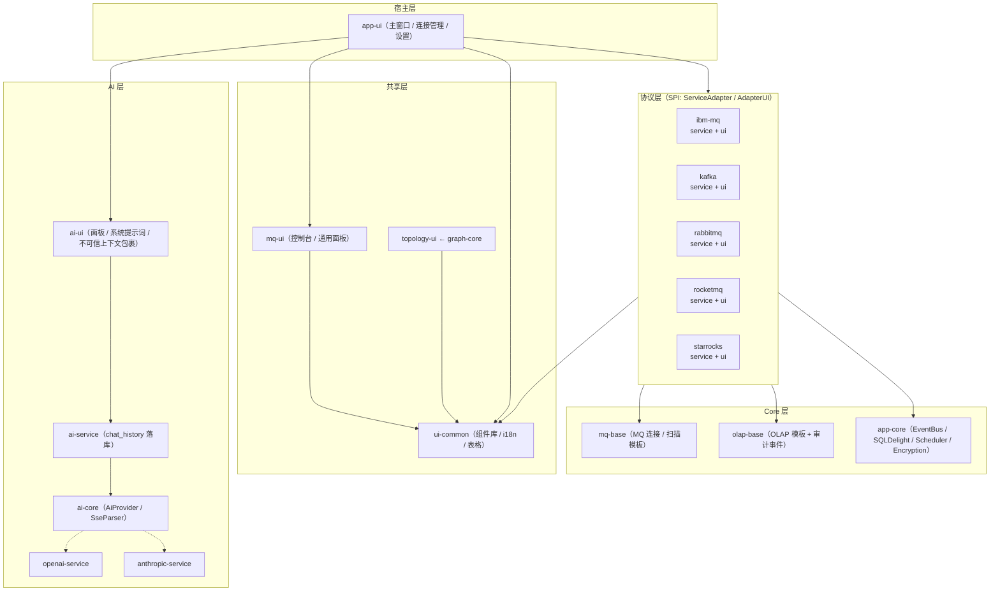

<div align="center">

# MQ Client Desktop

**面向消息中间件（IBM MQ / Kafka / RabbitMQ / RocketMQ）与 StarRocks 的本地桌面客户端。**
基于 Kotlin Multiplatform + Compose Desktop，所有数据保存在本机。

[](https://kotlinlang.org)
[](https://www.jetbrains.com/lp/compose-multiplatform/)
[](https://openjdk.org)
[](https://github.com/cashapp/sqldelight)
[](../LICENSE)

[English](../README.md) · **简体中文**

</div>

---

## 概述

MQ Client Desktop 是一个单窗口桌面应用，可连接四种消息中间件与 StarRocks。每种协议以
`service` / `ui` 模块对的形式通过 SPI 注册到宿主，删除任一协议模块不影响其余部分的编译。

连接配置、命令历史、查询历史与 AI 会话保存在本机 `~/.mqclient/` 目录下，不依赖中心服务。

### 支持的系统

| 类别 | 系统 | 范围 |
|---|---|---|
| 消息中间件 | IBM MQ、Kafka、RabbitMQ、RocketMQ | 对象浏览、消息浏览与发送、属性面板、拓扑 |
| OLAP | StarRocks | 数据目录、SQL 控制台、查询 Profile、集群与系统页 |

### AI 辅助诊断

对象页提供「询问 AI」入口。应用把该对象的上下文——属性、上下游拓扑、实时积压数据、集群关系
——组装为结构化文本，发送给 OpenAI 兼容或 Anthropic 端点（SSE 流式返回）：

```text
对象属性 + 上下游拓扑（谁生产、谁消费、经哪条通道）
        + 实时积压数据（队列深度 / 消费者数 / 通道状态）
        + 集群关系（是否集群成员、仓库角色）
                    ↓
      OpenAI 兼容 / Anthropic 适配器（SSE 流式）
                    ↓
「XMITQ 堆积 3200 条，DOWNSTREAM.CHL 状态 RETRYING，
  对端 QM2 的接收通道未运行。」← 返回的根因判断
```

各 MQ 模块提供自己的链路构建器（IBM MQ 为 `AiChainBuilder`，Kafka / RabbitMQ / RocketMQ 为
`KafkaAiChainBuilder` / `RabbitMqAiChainBuilder` / `RocketMqAiChainBuilder`）。
StarRocks 的 SQL 控制台与会话页提供慢查询诊断入口，上下文中包含 SQL 文本、`EXPLAIN` 计划
以及所引用表的字段结构。

## 能力范围

### 消息中间件

- **三层 SPI** —— `ServiceAdapter`（服务侧）、`AdapterUI`（UI 侧）、`MessageInterpreter`
  （消息体展示）。核心模块只定义契约，协议模块彼此平级。
- **各协议接入方式**：
  - **IBM MQ** —— PCF 对象扫描（队列 / 通道 / 监听器）、MQSC 命令控制台（含 MQRC 错误码
    翻译）、dmpmqmsg 搬移文件导入、基于 `CipherSuiteOptions` 的 TLS。
  - **Kafka** —— 通过 `assign + seek + poll` 直接读取：不加入消费组、不提交位移；单次读取
    支持多个起点，支持按分区续读。
  - **RabbitMQ** —— 管理 API 获取对象与状态；`basicGet` 浏览时消息保持未确认状态，关闭
    会话后重新入队；Stream 队列在建立 AMQP 连接前经管理 API 拦截。
  - **RocketMQ** —— Remoting 协议，支持 ACL 与 TLS；Topic 队列数达到 64 及以上时，改用
    8 个临时拉取消费者分片读取，超时按队列数计算。
- **拓扑视图** —— `graph-core`（图模型）+ `topology-ui`（Canvas 渲染）：节点拖拽、缩放、
  节点属性面板、PNG 导出。IBM MQ 采用按消息流向排列的固定列布局。
- **句柄生命周期** —— 重量级句柄（`AdminClient`、`MQQueueManager`、生产者）在连接级共享
  并以锁串行；轻量句柄（消费者、通道、JDBC Statement）按操作创建，在 `finally` 中关闭。
  `MQQueue` 按用途区分：浏览会话常驻一个句柄以保住服务端光标（会话关闭时释放），删除 /
  重入队 / 发送则每次新开并在 `finally` 关闭。
- **消息体解释器** —— JSON、XML、Hex、Base64、纯文本、SAP IDoc。
- **本地存储** —— SQLite（SQLDelight）保存连接快照、命令审计与 AI 历史；敏感字段经
  `@Sensitive` 注解加密。
- **双语界面** —— 各模块持有 zh-CN 与 en-US 两份资源表。

### StarRocks

- **连接** —— 使用 FE 查询端口（9030）的 MySQL 协议；可选 SSH 隧道，支持私钥或密码认证。
  首次连接时把主机密钥指纹（TOFU）记录到 `<configDir>/known_hosts`，格式为
  `主机 密钥类型 SHA-256 指纹`；之后每次连接进行比对，指纹变更时阻止连接，直至用户确认。
- **数据目录** —— 库、表、视图与物化视图树。选中表后右侧加载二维字段表（列名、类型、可空、
  键、默认值、Extra、注释）与 DDL 页签；分区信息在可折叠小节中给出摘要。
- **SQL 控制台** —— 标签栏下共用一份编辑器与结果区（各标签不维护独立文档）、执行选区或全文、
  多语句顺序执行、中断、流式结果（上限 50,000 行）、列排序、长值悬停与点击详情、CSV 导出
  （UTF-8 + BOM，先写临时文件再替换）、持久化执行历史（`olap_query_history`）。
- **会话与慢查询** —— `SHOW PROFILELIST` 列表；Profile 查看器执行
  `ANALYZE PROFILE FROM '<id>'`，语句报错或返回空文本时提示「Profile 未采集」。
- **集群页** —— 概览、三层拓扑（外部 Catalog → FE → BE/CN）与节点属性对话框、BE/CN 容量
  与心跳、高可用（主节点、多数派、可选举与观察者节点）、变量（会话 / 全局 / FE 配置）、
  经 FE Web 端口读取的 FE 日志尾部。
- **日志** —— `[StarRocks][Conn]` / `[SQL]` / `[Meta]` / `[Profile]` 结构化标签；SQL 语句
  截断至 500 字符；凭据不写入日志。

## 功能矩阵 —— 消息中间件

| 能力 | IBM MQ | Kafka | RabbitMQ | RocketMQ |
|:---|:---:|:---:|:---:|:---:|
| 对象扫描 / 健康度 | PCF（队列、通道、监听器） | Topic、消费组 | 交换机、队列、绑定、节点 | Topic、Group、集群 |
| 属性面板（分组管线） | 完整属性提取 | 支持 | 支持 | 支持 |
| 消息浏览 | 会话级常驻游标句柄（服务端 `BROWSE_NEXT` 翻页） | Assign + Seek，多起点 | `basicGet` 非破坏性读取 | 多队列并行，多起点 |
| 消息发送 | 支持 | 支持 | 批量文件、测试发布 | 支持 |
| 对象 CRUD | — | Topic 配置 | 交换机、绑定 | 支持，含前置校验 |
| 命令控制台 | MQSC（历史审计） | — | — | — |
| 原生拓扑 | 集群边关系 | 支持 | Exchange → Queue 路由 | 支持 |
| AI 链路诊断 | 支持 | 支持 | 支持 | 支持 |
| TLS / 自签证书 | 支持 | SASL_SSL | 支持 | 支持 |

## 功能矩阵 —— StarRocks

| 能力 | 状态 |
|:---|:---|
| 连接 | MySQL 协议；可选 SSH 隧道（私钥或密码）；TOFU 主机密钥校验 |
| 数据目录 | 库、表、视图、物化视图；字段表；DDL；分区摘要 |
| SQL 控制台 | 标签栏（共用编辑器与结果区）、选区执行、多语句、中断、流式结果、排序、CSV 导出、历史 |
| 诊断 | `SHOW PROFILELIST`；`ANALYZE PROFILE FROM '<id>'`；AI 慢查询分析 |
| 集群 | 概览、拓扑、BE/CN、高可用、变量与 FE 配置、FE 日志 |
| 对象 DDL/DML | 仅通过 SQL 控制台执行（不提供 GUI 对象编辑） |

## 系统架构



依赖方向为 UI → service → `mq-base` / `olap-base` / `app-core`，单向；反向通过 EventBus
事件与 SPI 回调。每种协议是一对平级的 `service` / `ui` 模块，新增协议即新增一对模块并注册
SPI。

> 逐模块说明、分业务域功能清单与代码量化指标见 [`ARCHITECTURE.md`](ARCHITECTURE.md)。

## 项目结构

```text
mq-client/
├── app-core/            # EventBus、SQLDelight（6 表）、调度、加密、SPI 契约
├── mq-base/             # AbstractConnectionManager / AbstractScanService 模板
├── olap-base/           # OLAP 模板：AbstractAnalyticsConnectionManager（已接入）+ 目录 / 查询模板
├── ui-common/           # 组件库：对话框、PropertyTable、DataGrid、i18n
├── mq-ui/               # MQ 通用 UI：命令控制台、对象列表面板、MetricCard
├── graph-core/          # 拓扑图模型（TopologyData / TopologyNode）
├── topology-ui/         # Canvas 渲染：拖拽、缩放、PNG 导出
├── ibm-mq-service/  ibm-mq-ui/       # IBM MQ（PCF、MQSC、dmpmqmsg）
├── kafka-service/   kafka-ui/        # Kafka（Assign + Seek）
├── rabbitmq-service/ rabbitmq-ui/    # RabbitMQ（管理 API、basicGet）
├── rocketmq-service/ rocketmq-ui/    # RocketMQ（Remoting、并行拉取）
├── starrocks-service/ starrocks-ui/  # StarRocks（数据目录、SQL 控制台、Profile、集群页）
├── ai-core/  ai-service/  ai-ui/     # AI 诊断栈
├── openai-service/  openai-ui/       # Provider 模块对
├── anthropic-service/ anthropic-ui/  # Provider 模块对
├── message-interpreter-api/          # 消息解释器 SPI
│   ├── -json / -xml / -hex / -base64 / -text / -idoc
│   └── -registry                     # 聚合注册
├── ui-test-kit/  test-support/       # Compose 画布测试工具 / LiveTest SKIP 包装
└── app-ui/              # 桌面宿主（Main.kt / 打包配置）
```

## 快速开始

**环境要求**：JDK 25（构建使用 `jvmToolchain(25)`），Gradle wrapper 9.7.1。

```bash
git clone <your-repo-url>
cd mq-client
./gradlew :app-ui:run          # 开发运行
```

**自检**（架构规则 + 编译 + 单元测试 + i18n 键检查）：

```bash
bash ./scripts/verify.sh
```

**打包分发**（免安装 zip，不提供安装器）：

```bash
./build.bat            # Windows
./build.sh             # Linux / macOS
# 或直接走 gradle：
./gradlew :app-ui:zipDistributable
```

产物写入 `app-ui/build/compose/binaries/main/`，命名为 `MQClient-0.2.0-<os>-<arch>.zip`。
jpackage 只能打包当前操作系统，各平台的 zip 需在对应平台构建。压缩包内含精简 JRE，解压后
运行 `MQClient/MQClient.exe`（Windows）或 `./MQClient/bin/MQClient`（Linux/macOS）。

**数据目录** —— 所有数据保存在 `~/.mqclient/`：

```text
~/.mqclient/
├── config.toml    # 连接与应用配置
├── secret.key     # 敏感字段加密密钥
├── mqclient.db    # SQLite：mq_connection / mq_command / ai_connection / chat_history
│                  #         olap_query_history / olap_draft
├── known_hosts    # StarRocks SSH 隧道记住的主机密钥（主机、密钥类型、SHA-256 指纹）
└── logs/          # 运行日志，含 [MQ-Perf] 与 [StarRocks] 打点
```

## 代码规模

以下数据在 0.2.0 发布时对工作区统计（`find` / `wc -l` 覆盖 `src/**/*.kt`，排除 `build/`）：

| 指标 | 数值 |
|:---|:---|
| Gradle 模块 | 35（+ included build：版本目录 / 约定插件） |
| Kotlin 文件 | 753（主代码 532，测试 221） |
| Kotlin 行数 | 119,328（主代码 90,104，测试 29,224） |
| `@Composable` 声明 | 522 |
| `suspend fun` 声明 | 527（含 `expect` / `actual` 对） |
| SQLDelight 表 | 6 |

## 已知限制

- 对象 DDL 与 DML 仅通过 SQL 控制台执行，不提供 GUI 对象编辑。
- SQL 控制台无自动补全、无格式化，也无库选择器；会话使用连接配置的默认库，除非手动执行 `USE`。
- 控制台的标签共用一份编辑器与结果区，切换标签不切换文档。
- 一个连接同一时刻只执行一条语句（单槽共享会话）。
- 结果集上限 50,000 行，超出部分截断并以横幅提示，不支持分页续取。
- 连接表单无独立 TLS 开关，TLS 参数经 `jdbcUrlOverride` 传入。
- StarRocks 仅在单机 StarRocks 3.4.0 上验证，未在多 BE 生产集群或其他版本上验证。

## 贡献指南

欢迎 Bug 报告、功能建议、文档修正与代码 PR。

```bash
# 1. Fork 并创建分支
git checkout -b feat/your-feature

# 2. 开发自检：编译 + 单元测试
./gradlew build
./gradlew jvmTest

# 3. 提交并发起 Pull Request
```

**约定**：

- **提交信息** —— 遵循 Conventional Commits（`feat:` / `fix:` / `refactor:` / `docs:`），
  正文说明动机与影响范围。
- **i18n** —— 所有用户可见文案必须同时提供 `zh-CN` 与 `en-US` 资源，禁止硬编码字符串。
- **UI 组件** —— 优先复用 `ui-common` 既有组件（`PropertyTable`、`DataGrid`、
  `PrimaryButton` / `SecondaryButton` / `DangerButton`、`ObjectDetailDialog`），不另写同类实现。
- **架构边界** —— `service` 模块不得依赖 `ui` 模块；跨模块通信通过 SPI 契约与 EventBus。
- **错误处理** —— 原始错误码与异常栈只写日志，UI 展示经 `userMessage()` 翻译的文案。
- **句柄生命周期** —— 重量级句柄连接级共享并加锁串行；轻量句柄按操作创建，在 `finally`
  中关闭；浏览游标句柄例外，它在会话期间保持打开以保证翻页在服务端完成。
- **测试** —— 新增 service 层逻辑需附带 `jvmTest`。协议行为用例不依赖真实中间件；真实环境
  校验以 `*LiveTest` 形式存在，经 `-D*.live.enabled=true` 开启，环境缺失时跳过。

**Issue 规范**：附上操作系统、JDK 版本、复现步骤，以及 `~/.mqclient/logs/` 中的相关日志
片段（请先脱敏）。

## License

本项目基于 [Apache License 2.0](../LICENSE) 发布。

```text
Copyright 2026 Lindc

Licensed under the Apache License, Version 2.0 (the "License");
you may not use this file except in compliance with the License.
You may obtain a copy of the License at

    http://www.apache.org/licenses/LICENSE-2.0
```
